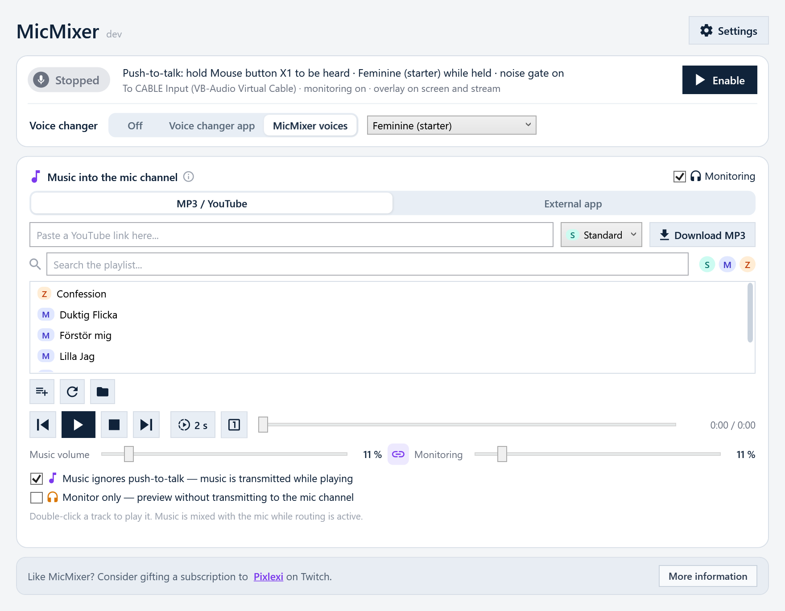

# MicMixer

MicMixer mixes your microphone, a voice changer and music into one virtual
microphone, and gives each of them its own push-to-talk rule. FiveM, Discord and
other apps that accept a single microphone see an ordinary input. You decide
what goes into it, and you can switch while you play.

[**Download for Windows**](https://github.com/benjibutten/MicMixer/releases/latest)
· Windows 10/11 x64 · free and open source



## What you can do with it

- Play music into a game without holding the game's push-to-talk key.
  MicMixer's own push-to-talk gates your voice while the music keeps playing,
  and MicMixer can hold the game's talk key for you whenever it sends.
- Switch to a voice changer with a key. Hold the hotkey for the modified voice,
  from an app such as Voicemod or from MicMixer's own voices, and release it to
  go back.
- Send a separate mix to OBS or Streamlabs. The secondary output plays mic and
  music on an extra device with its own push-to-talk rule, so your stream hears
  everything while the game hears only what you let through.

There is also a noise gate, music that lowers itself while you talk, an MP3
library with YouTube download, capture from apps such as Spotify, and a status
overlay for your screen and your stream. The [manual](docs/manual.md) describes
all of it.

## Install

Download the installer from the
[latest release](https://github.com/benjibutten/MicMixer/releases/latest) and
run it, or install with winget:

```powershell
winget install --id BenjiButten.MicMixer --exact
```

The release also has the app as a zip that runs from any folder without
administrator rights. Nothing else is needed: .NET is included.

Releases are unsigned, so Windows SmartScreen may show **Windows protected your
PC**. Every download has a `.sha256` file next to it, and
[INSTALLATION.txt](INSTALLATION.txt) shows how to check it before you choose
**More info → Run anyway**. Releases are built by GitHub Actions from the tagged
commit. See the
[code signing policy](https://benjibutten.github.io/MicMixer/code-signing-policy.html)
and the [privacy policy](https://benjibutten.github.io/MicMixer/privacy.html).

## Set up

MicMixer needs a virtual audio cable to play the mix into. The installer offers
to install [VB-CABLE](https://vb-audio.com/Cable/). With the zip or winget,
install it yourself.

1. Start MicMixer and follow the setup guide that opens. It finds the cable and
   helps you pick your microphone and hotkey.
2. In FiveM, Discord, or your chat app, select the cable's output end as the
   microphone: **CABLE Output**, or **MicMixer Output** if the installer named it.
3. Click **Enable** in MicMixer.

## Documentation

- [Manual](docs/manual.md): every setting, music routing, the overlay,
  troubleshooting, and where settings and logs are stored.
- [Play music in FiveM without holding push-to-talk](docs/guides/fivem-music-through-mic.md)
- [Mic and music as one Discord input](docs/guides/discord-single-input.md)
- [Stream overlay](docs/stream-overlay.md) for OBS and other streaming software.
- [Control API](docs/control-api.md) for controlling the music player from another app.
- [INSTALLATION.txt](INSTALLATION.txt), which also ships with every release.

The same guides are on the [website](https://benjibutten.github.io/MicMixer/).

## Building

```powershell
dotnet build .\MicMixer.slnx
pwsh -File .\scripts\Test.ps1
```

[CONTRIBUTING.md](CONTRIBUTING.md) has the publish commands and explains how
releases are made.

## Thanks

MicMixer is built and maintained by BenjiButten and is free of charge. Thank you
to [Pixlexi](https://www.twitch.tv/pixlexi), who came up with the use cases
behind the app and has tested it and given feedback all the way.

If you enjoy MicMixer and want to give something back, consider gifting a sub to
[Pixlexi](https://www.twitch.tv/pixlexi) on Twitch.

## License

MicMixer is licensed under the [Apache License 2.0](LICENSE). Redistributions
must keep the attribution in [NOTICE](NOTICE). Third-party components and their
licenses are listed in [THIRD-PARTY-NOTICES.txt](THIRD-PARTY-NOTICES.txt).

Releases up to and including `v2026.7.3` remain available under the MIT terms
they were published under.
