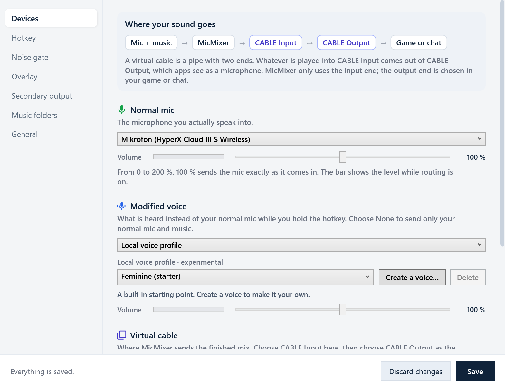

# MicMixer manual

The reference for everything in MicMixer. For a first setup, the
[README](../README.md#set-up) is shorter, and the guides walk through the two
most common uses:

- [Play music in FiveM without holding push-to-talk](guides/fivem-music-through-mic.md)
- [Mic and music as one Discord input](guides/discord-single-input.md)

## Requirements

- Windows 10 or Windows 11, x64.
- A microphone.
- A virtual audio cable. [VB-CABLE](https://vb-audio.com/Cable/) is recommended.
- Optional: Voicemod or another voice changer that has its own microphone device.
- Internet access for the first music download. MicMixer downloads `yt-dlp` and
  `ffmpeg` to its local application-data folder and verifies them with SHA-256.
  YouTube downloads also install the `deno` JavaScript runtime there.

Releases are self-contained, so you normally don't need to install .NET.

## Installing

The installer, `MicMixer-<version>-win-x64-setup.exe`, puts MicMixer in Program
Files and adds it to the Start menu and to Apps in Windows Settings. The same
release has the app as a zip, `MicMixer-<version>-win-x64.zip`, to extract and
run from a folder of your choice. [INSTALLATION.txt](../INSTALLATION.txt) covers
both, along with how to verify a download.

When Windows has no VB-CABLE yet, the installer offers to install it and to name
its two ends **MicMixer Input** and **MicMixer Output**. VB-CABLE is made by
VB-Audio Software: the origin of VB-CABLE is [www.vb-cable.com](https://vb-audio.com/Cable/),
and VB-CABLE is a donationware, all participations are welcome. You can untick
the option to use another cable or install it by hand. Uninstalling MicMixer
leaves VB-CABLE in place.

## Basic setup

On the first start, a setup guide opens inside the app. It explains how a
virtual cable works, recognizes an installed VB-CABLE, Virtual Audio Cable or
Voicemeeter (or walks you through installing VB-CABLE), and helps you pick your
microphone, the cable, your monitoring device and the hotkey. **Finish** saves
the choices and can start routing right away. Run it again from
**Settings › General**.

To set up by hand:

1. Install [VB-CABLE](https://vb-audio.com/Cable/) and restart Windows if the
   installer asks.
2. In MicMixer, open **Settings › Devices**.
3. Select your physical microphone under **Normal mic**.
4. Under **Voice changer**, choose **Off**, **Voice changer app** (then select its
   microphone, such as **Voicemod Virtual Audio Device**), or **MicMixer voices**.
5. Under **Virtual cable**, set **Send the mix to** to **CABLE Input (VB-Audio Virtual Cable)**.
6. Click **Save**.
7. In your voice chat, game, or streaming app, select **CABLE Output** as the microphone.
8. Click **Enable** in the main window.

A virtual cable is a pipe with two ends: MicMixer plays the mix into CABLE
*Input*, and every other app picks CABLE *Output* as its microphone.

If the selected output does not look like a virtual cable, MicMixer shows a
warning. Click **Enable** again to continue with another cable driver or an
output you chose on purpose.

## Main window and settings

The main window holds what you use during a session: a status card, the music
player, and orange problem cards. Everything you set up once lives in a separate
**Settings** window with the pages Devices, Hotkey, Noise gate, Overlay,
Secondary output, Music and General.



- The status card shows whether you are heard (gray Stopped, green Live, blue
  Modified voice, red Muted), what the hotkey does right now, and where the mix
  goes.
- Settings changes apply immediately, but are kept for the next start only after
  **Save**, which also closes the window. **Cancel** returns to the saved settings
  and closes it. Closing it with its **×** leaves unsaved changes in use until
  MicMixer restarts.
- While routing is on, the microphones, the virtual cable and the secondary output
  are locked because they are in use. A banner at the top of the settings window
  says so and offers **Stop routing**.
- The saved settings are the reference for the problem cards. When a saved
  device is not connected, the secondary output is misconfigured or fails, or
  settings are changed but not saved, the main window shows one card per problem
  with a button to the settings page that fixes it.
- MicMixer never replaces a saved device with a stand-in without saying so, and
  starting routing never overwrites the saved devices. Devices coming and going are
  noticed while routing is off, so a card clears itself once the device is back.
- Music card controls (volumes, monitoring on/off, the music routing toggles,
  source mode), the voice changer and its voice, and music folders are saved as
  they change.
- **Settings › General › What's new…** shows the release notes of the running version.

## Starting, the tray and updates

MicMixer keeps running in the system tray. Closing the window with **×** hides
it there, and **Exit** in the tray menu quits. Starting MicMixer a second time
brings up the copy that is already running. On Windows 11, MicMixer places its
tray icon on the taskbar instead of in the overflow menu, unless you have
already chosen where it goes in Windows settings.

Two options save clicks at startup:

- **Start MicMixer with Windows** (**Settings › General**) starts it hidden in
  the tray when you sign in.
- **Enable when MicMixer starts**, under the **Enable** button in the main
  window, turns routing on at every start. It is saved as soon as you tick it.
  Your mic is then open from the start unless push-to-talk is on. If a saved
  device is not connected, routing does not start by itself: the problem card
  says what is missing, and **Enable** still works.

Release builds check GitHub for updates at most once every 12 hours while the
main window is open. When a newer version is available, MicMixer can download,
verify, install, and restart itself. **About › Check for updates** checks at
once. A copy installed with the installer updates by running the new installer,
which asks for UAC approval unless MicMixer runs as administrator. A copy
extracted from the zip replaces its own files. A copy installed with winget is
updated with `winget upgrade` and leaves the built-in updater alone. After an
update, MicMixer shows the new version's release notes once. Development builds
do not check for updates.

## Run as administrator

While a game or program running as administrator has focus, Windows keeps the
hotkey from reaching a MicMixer that is not, and drops the keys it holds. When
MicMixer notices such a program taking focus, it says so in the main window with
a button that restarts it as administrator. The option is also in the installer
and in **Settings › General**, and it needs a Windows account with administrator
rights.

- Installed with the installer and set to start with Windows, MicMixer starts as
  administrator at sign-in through Task Scheduler, without a UAC prompt. From
  any other folder it does not, because Windows would start whatever program
  replaced `MicMixer.exe` there as administrator.
- Running as administrator, MicMixer still starts yt-dlp, the browser and File
  Explorer without administrator rights.
- On Windows 11 it does not follow folder junctions made without administrator
  rights, so a music folder reached through such a junction stays empty.
- It starts as administrator through `MicMixer.Launcher.exe`, a small native
  program that first removes the `DOTNET_*`, `COMPlus_*`, `CORECLR_*` and
  `COREHOST_*` environment variables. Any program can set those to load a DLL,
  such as a profiler, into the .NET runtime.

## Hotkey and push-to-talk

In **Settings › Hotkey**, click **Change**, then press the keyboard key or mouse
button that should select the modified mic while routing is active. **Add hotkey**
adds more keys or buttons that do exactly the same. The hotkey counts as held
while any of them is held.

- Hotkey held: the modified mic is routed.
- Hotkey released: the normal mic is routed.
- Release delay above `0 ms`: the modified mic remains active until the delay ends.

The **Voice changer** decides what the hotkey switches to. Switch it from the row
under the status card in the main window, or in **Settings › Devices**. It takes
effect immediately. If routing is on, routing restarts for a moment.

- **Off**: the hotkey is disabled unless push-to-talk is enabled.
- **Voice changer app**: for apps such as Voicemod that create their own microphone
  device. Select that device in **Settings › Devices**.
- **MicMixer voices** (experimental): MicMixer changes your voice itself, from your
  physical microphone, with no other app. Pick a voice next to the switch, or create,
  edit and delete your own voices in **Settings › Devices**. Its **Volume** slider there
  adjusts the processed voice only, from 0 to 200%, while routing is active.

**Volume** under the normal mic adjusts only the normal mic, on the same 0–200%
scale. 100% sends it exactly as captured. MicMixer never lowers the normal mic
on its own. Raise this if it sounds quieter than your modified voice, or lower
the modified voice next to it.

### Push-to-talk

Push-to-talk reverses the idle behavior: while the hotkey is not held, the virtual
cable receives silence. Neither microphone audio nor music is sent.

- It also works with the voice changer **Off**, in which case the hotkey gates the normal mic.
- With a modified mic selected, holding the hotkey both opens the gate and selects it.
- The release delay applies to push-to-talk as well.
- Local music monitoring is not muted by push-to-talk.
- The tray icon and overlay turn red with a crossed-out mic while the outgoing mix
  is muted.
- With **Music ignores push-to-talk** enabled (music card), push-to-talk gates
  only the microphone: the music keeps flowing into the virtual cable as long as
  it plays. See [Music routing](#music-routing).

### Hold a key while sending

**Hold a key while sending** (same page) holds a chosen key, F13–F24, down for
as long as mic or music reaches the virtual cable, and lets go shortly after.
With push-to-talk, that is for as long as you hold the hotkey. Bind another
app's push-to-talk to that key and it transmits exactly when MicMixer does, also
while MicMixer is in the background. While music plays, the press is repeated
every second, so a game that lost the key while you switched windows picks it up
again.

F13–F24 are not on a normal keyboard. Click **Send key once**, switch to the
other app and start its key binding, and MicMixer sends the key after 5 seconds.

### Noise gate

The noise gate mutes the mic whenever its level stays below the threshold, so
the cable carries true digital silence between phrases instead of room noise
and hum. Apps that use voice activation on the cable then stop treating you as
talking the moment you stop speaking, even while the push-to-talk key is still
held.

- The gate opens within a few milliseconds and stays open for a quarter second
  after the level drops, so short pauses do not chop words.
- The bar under the slider shows the mic level on the same scale. Set the
  threshold so the bar passes the knob while you talk and stays below it while
  you are quiet. The label next to it tells whether the gate is open or closed.
- It applies to the normal and the modified mic alike and works together with
  push-to-talk. Music is not affected.

## Music sources

MicMixer can play its own MP3 library or capture audio from another application.
In either mode, the audio is mixed into the same virtual microphone as your
voice.

### MP3 library

Add music by pasting a YouTube link and clicking **Download MP3**, or by putting
your own `.mp3` files in a configured music folder.

Only links to a single video are accepted. A YouTube search, playlist, or
channel link is refused with an explanation, and a video link that carries a mix
or radio list downloads just that one video.

The first download installs local copies of `yt-dlp` and `ffmpeg`. YouTube
downloads also install `deno`, the JavaScript runtime `yt-dlp` uses to
unscramble YouTube's media links. These are fairly large, so the first download
takes longer. Later downloads reuse them.

The library has search, playback controls, a queue, and multiple music folders.
With more than one folder:

- Each track has a colored folder badge. Hover over it to see the full path.
- Folder chips beside the search field filter the visible tracks.
- The download destination can be selected separately.
- Folders are added or removed in **Settings › Music**. At least one folder
  remains configured.

Music can play while routing or local monitoring provides an audio clock. If neither
is active, playback pauses instead of appearing to play without advancing.

### External application capture

Select the external-application source mode to capture audio from a running
application such as Spotify and route it through MicMixer. Refresh the application
list when a newly started app is not shown. Transport buttons send system media-key
commands to the active media application.

Capture depends on the Windows process-loopback APIs and on the selected
application producing audio.

## Local monitoring

Monitoring plays library music through your own headphones or speakers. It has a
separate device and volume control and does not change the level sent to other
people through the virtual microphone. Select a physical playback device, not
the virtual cable.

## Music routing

Two toggles in the music card control how the music relates to push-to-talk and
the virtual cable. Both apply immediately, also while routing runs, and both work
in external capture mode as well.

- **Music ignores push-to-talk**: the music keeps flowing into the virtual
  cable as long as it plays, while push-to-talk still gates the microphone.
  The game hears the music continuously, but your voice only while you hold the
  hotkey. The toggle is only active while push-to-talk is enabled. Without
  push-to-talk, playing music is always sent.
- **Monitor only**: preview mode. The music is never sent to the virtual
  cable. You hear it through local monitoring and can check a track or set its
  volume before anyone else hears it. The secondary output still receives the
  music, so streaming or recording software capturing that device hears what you
  hear. An amber hint below the toggle states where the music goes while the
  mode is active. Monitor-only overrides the ignore-push-to-talk toggle. It is
  off each time MicMixer starts.

The status card and the overlay reflect the outcome: when push-to-talk mutes the
mic while music still flows, the pill reads **Mic muted** and the status line
adds "music is still transmitting", and the overlay's music circle shows the
current destination.

### Lower the music while you talk

**Lower the music while you talk** (**Settings › Music**) turns the music down to a
set share of its volume, 25 % by default, while your mic reaches the virtual cable,
and brings it back up once you are quiet. It glides down in a few hundredths of a
second, so your first word is already on top, and up over about half a second, so
the music does not jump between phrases.

Push-to-talk or the noise gate decides when you talk. With push-to-talk alone the
music stays lowered for as long as you hold the hotkey, and with the noise gate on
it comes back up in the pauses between phrases. Push-to-talk alone counts only
when **Music ignores push-to-talk** is on, since otherwise the music reaches the
cable only while you hold the hotkey anyway. Without either, MicMixer cannot
tell when you talk and leaves the music as it is. The virtual cable and the
secondary output are both lowered. Local monitoring is not.

## Secondary output

The secondary output routes the finished mix, microphone and music, to one extra
playback device while routing is active. It has its own gates, independent of
the cable's. With **Ignore push-to-talk** enabled (the default), the secondary
device keeps receiving mic and music even while the virtual cable receives
silence. Disable that option to make the secondary microphone follow the same
push-to-talk gate as the cable. The music then still flows whenever you can hear
it (while it is sent to the cable or previewed in monitor-only mode), so a
stream capturing the secondary device always hears the music you hear.

With streaming or recording software:

1. Enable **Secondary output** and select a playback device that you are not
   otherwise using, for example an unused HDMI output or a virtual device.
2. In your streaming software (for example OBS Studio or Streamlabs Desktop),
   add an audio output capture source and select the same device.
3. Start routing in MicMixer. The software now records or streams the full mix,
   including everything you say while push-to-talk is released.

Keep in mind:

- The secondary device plays your own microphone. If you pick your normal
  speakers, everyone in the room hears your mic and you risk feedback. Prefer a
  device you cannot hear, or headphones.
- The capture source includes everything on that device. Any other application
  playing audio to the same device ends up in the recording.
- The secondary output can never use the same device as the virtual cable
  (**Send the mix to**). MicMixer blocks that combination because the mix would
  play twice on the cable.
- If the saved secondary device is missing at startup, MicMixer leaves the
  selection empty and refuses to start the secondary output until you pick a
  device again. It never substitutes another output on its own.

The secondary volume only affects the secondary device. A failure on the
secondary device, such as unplugging it, closes only the secondary branch.
Routing to the virtual cable continues.

## Overlay indicator

The optional click-through overlay stays visible above borderless and windowed
games without stealing focus or intercepting the mouse. The mic circle shows the
same status colors and glyphs as the tray icon:

- Green with a mic: the normal microphone is heard.
- Blue with a modified-mic glyph: the modified microphone is heard.
- Red with a crossed-out mic: push-to-talk is muted.
- Gray (tray icon only): routing is stopped.

While music is active, a separate music circle appears to the left of the mic
circle and tells where the music goes:

- Purple with a note and dancing equalizer bars: the music is sent into the mic
  channel.
- Amber with headphones: monitor-only preview. Only you (and the secondary
  output) hear it.
- Gray with a crossed-out note and frozen bars: the music plays but push-to-talk
  currently blocks it from the cable.

The optional level rings wrap each circle. The mic ring shows the complete
outgoing mix after the gates, which is exactly what the cable receives. The
music ring shows the music branch alone after the music volume, also during a
monitor-only preview, so the level can be set before anyone else hears it.
Exclusive fullscreen applications may keep desktop overlays from showing.

## Stream overlay

When streaming software captures a game as an individual process, desktop
overlays may not be part of the captured image, so viewers never see the overlay
indicator. Enable **Serve the stream overlay** in **Settings › Overlay** and
MicMixer serves the same overlay as a local web page (`http://127.0.0.1:4573/`
by default) that can be added as a browser source and layered on top of the
game. The page mirrors the desktop overlay, including the hidden state while
routing is stopped, and reconnects when MicMixer restarts. See
[the stream overlay guide](stream-overlay.md) for setup steps, URL parameters,
and the wire protocol.

## Local data

MicMixer stores settings, its default music folder, downloaded tools, and logs in:

```text
%LocalAppData%\MicMixer
```

- `settings.json`: devices, hotkey, volumes, folders, window state, and other settings.
- `Music\`: the default MP3 library folder.
- `tools\`: downloaded `yt-dlp`, `ffmpeg`, and `deno` binaries.
- `logs\micmixer-YYYYMMDD.log`: runtime logs.
- `startup-timeline.log`: a basic startup timeline.

Runtime logs roll at 5 MB, rotate daily, and are kept for 14 days.

## Troubleshooting

- Nobody hears anything: confirm that MicMixer outputs to **CABLE Input** and
  that the receiving application uses **CABLE Output** as its microphone.
- Others cannot hear the music: confirm that routing is active, and disable noise
  suppression, echo cancellation, and automatic gain control in the receiving app.
- Local monitoring is silent: enable monitoring and select your headphones or
  speakers as the monitor device.
- External application capture is silent: make sure the selected app is
  producing audio, and refresh the application list.
- A download fails: check the internet connection and look at the logs under
  `%LocalAppData%\MicMixer\logs`.
- An audio device was disconnected: reconnect it. MicMixer picks it up again by
  itself when routing is off, and its card disappears. While routing is on, the
  card stays until you stop routing, because the route keeps using the device it
  started with. **Refresh devices** in Settings › Devices reads the devices again
  at once, but stops routing first. Music that paused because the monitoring device
  was unplugged resumes when that device is back, not on a stand-in device.
- The secondary output shows "device was not found": reconnect the device or
  select a new one. MicMixer never picks a replacement secondary device itself.
